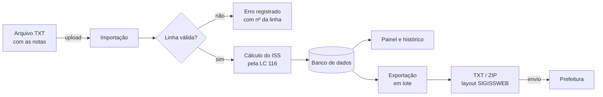
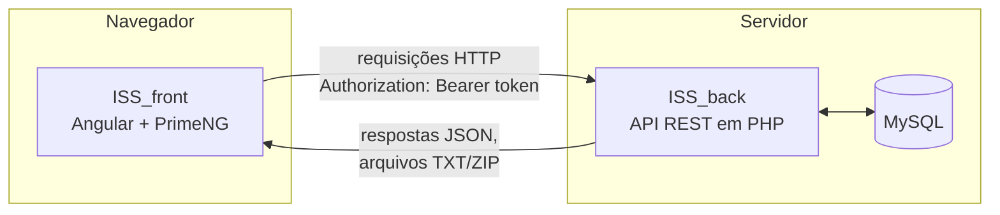

<div align="center">


# ISS Solution

**Plataforma web para importar notas fiscais de serviço, calcular o ISS e gerar os arquivos de declaração do SIGISSWEB.**

Projeto acadêmico desenvolvido por alunos do **SENAI**

<br />


[Sobre](#-sobre-o-projeto) •
[Funcionalidades](#-funcionalidades) •
[Como funciona](#-como-funciona) •
[Como executar](#-como-executar) •
[Guia de uso](#-guia-de-uso) •
[Equipe](#-equipe)

</div>

---

## Sobre o projeto

O **ISS Solution** é um projeto **institucional e educacional** desenvolvido por alunos do **SENAI** como parte da formação técnica <!--  informe o curso, ex.: "do curso Técnico em Desenvolvimento de Sistemas" --> na unidade <!--  informe a unidade, ex.: "SENAI Cidade/UF" -->.

O objetivo foi resolver um problema real do dia a dia de escritórios contábeis e empresas prestadoras de serviço: **transformar planilhas e arquivos de notas fiscais em declarações de ISS prontas para envio à prefeitura**, sem digitação manual e com validação antes do envio.

Durante o desenvolvimento, a equipe praticou o ciclo completo de um software profissional: levantamento de requisitos, modelagem de banco de dados, construção de uma API REST, desenvolvimento de interface web, autenticação, versionamento com Git e documentação.

> Este repositório contém o **frontend** (interface web). O backend (API em PHP + MySQL) está em **[ISS_back](https://github.com/vinicius-31008/ISS_back)**.

---

## Entendendo o problema

Se você não é da área fiscal, aqui vai o contexto em poucas linhas:

| Termo | O que significa |
|---|---|
| **ISS** | *Imposto Sobre Serviços*, cobrado pelos municípios sobre serviços prestados (consultoria, manutenção, desenvolvimento de software etc.). |
| **NFS-e** | *Nota Fiscal de Serviço eletrônica*: o documento que registra cada serviço prestado. |
| **LC 116** | Lei Complementar 116/2003, que lista os tipos de serviço (ex.: `1.01` – análise e desenvolvimento de sistemas). Cada código tem uma alíquota de ISS. |
| **Competência** | O mês/ano a que a nota se refere (ex.: `08/2026`). A declaração é feita por competência. |
| **SIGISSWEB** | Sistema usado por prefeituras (como Santa Bárbara d'Oeste/SP) para receber a declaração do ISS, por meio de um arquivo TXT em layout fixo. |

**O desafio:** o arquivo do SIGISSWEB tem **largura fixa**: cada informação ocupa posições exatas da linha (ex.: o CNPJ fica da coluna 32 à 45). Um único caractere fora do lugar faz a prefeitura rejeitar o arquivo. O ISS Solution gera esse arquivo automaticamente e valida as notas antes.

---

## Funcionalidades

| | Funcionalidade | Descrição |
|---|---|---|
| 🔐 | **Login e perfis** | Acesso com usuário e senha, sessão por token e perfis `ADMIN` e `USUÁRIO`. Senha provisória obriga a troca no primeiro acesso. |
| 📊 | **Painel (dashboard)** | Indicadores de ISS, valor de serviços, notas e importações, com gráficos por mês, por status e por serviço, ranking de tomadores e últimas importações. |
| 📥 | **Importação de notas** | Envio de arquivo TXT com as notas; o sistema valida linha a linha, calcula o ISS e aponta os erros com o número da linha. |
| 🗂️ | **Histórico** | Lista de importações com filtros (status, arquivo, período) e detalhe de cada uma, com notas e erros. |
| 📤 | **Exportação em lote** | Seleção de várias notas para gerar os TXT do SIGISSWEB. Um arquivo por prestador e competência; vários arquivos são entregues em um **ZIP**. |
| 🧪 | **Modo homologação** | Gera o arquivo marcado como teste, para o SIGISSWEB apenas validar, sem efetivar a declaração. |
| 🏢 | **Administração** | Cadastro de empresas e usuários (somente `ADMIN`). Cada empresa só enxerga as próprias notas. |
| 🌗 | **Tema claro/escuro** | Interface responsiva, com troca de tema e de cor principal. |

<!--
 Dica: adicione capturas de tela em docs/screenshots/ e descomente o bloco abaixo.

<div align="center">
  
  
</div>
-->

---

## Como funciona

O caminho de uma nota, do arquivo até a prefeitura:



### Arquitetura

O sistema é dividido em duas partes que conversam por HTTP/JSON:



- **Frontend (este repositório):** telas, gráficos, validações de formulário e download dos arquivos.
- **Backend ([ISS_back](https://github.com/vinicius-31008/ISS_back)):** autenticação, regras de negócio, cálculo do ISS, geração do layout SIGISSWEB e acesso ao banco.

---

##  Tecnologias

| Camada | Tecnologia | Para que usamos |
|---|---|---|
| Interface | [Angular 21](https://angular.dev) | Framework do frontend (componentes standalone, *signals*, *zoneless*) |
| Componentes | [PrimeNG 21](https://primeng.org) + PrimeIcons | Tabelas, seletores, botões e ícones |
| Estilo | SCSS + Tailwind CSS | Layout responsivo e temas claro/escuro |
| Gráficos | [Chart.js 4](https://www.chartjs.org) | Gráficos do painel |
| Linguagem | TypeScript | Tipagem e organização do código |
| API | PHP 8.3 | Endpoints REST |
| Banco | MySQL | Notas, prestadores, tomadores, serviços, usuários |

> O layout base da interface parte do template open source [Sakai NG](https://github.com/primefaces/sakai-ng), da PrimeFaces, adaptado para o projeto.

---

## Como executar

### Pré-requisitos

- [Node.js](https://nodejs.org) 20 ou superior
- [PHP](https://www.php.net) 8.3 com as extensões `mysqli` e `mbstring`
- MySQL 8 (ou MariaDB)
- [Git](https://git-scm.com)

### 1. Suba o backend

```bash
git clone https://github.com/vinicius-31008/ISS_back.git
cd ISS_back
# crie o banco a partir do BancoDeDados.sql e ajuste src/conexao.php
php -S localhost:8000
```

Teste se a API respondeu: <http://localhost:8000/src/api/health.php>

> Os detalhes de banco, migrações e criação do primeiro usuário estão no README do [ISS_back](https://github.com/vinicius-31008/ISS_back).

### 2. Suba o frontend

```bash
git clone https://github.com/vinicius-31008/ISS_front.git
cd ISS_front
npm install
npm start
```

Acesse <http://localhost:4200> 

> Se a API estiver em outro endereço, altere `API_URL` em [`src/app/layout/service/importar.service.ts`](src/app/layout/service/importar.service.ts).

### Comandos úteis

| Comando | O que faz |
|---|---|
| `npm start` | Servidor de desenvolvimento com recarga automática |
| `npm run build` | Gera a versão de produção em `dist/` |
| `npm test` | Executa os testes |
| `npm run format` | Formata o código com Prettier |

---

##  Guia de uso

###  Entre no sistema

Faça login com o usuário criado no backend. No primeiro acesso com senha provisória, o sistema pede a troca de senha.

###  Importe as notas

No menu **Notas Fiscais → Importar**, envie um arquivo `.txt` com **uma nota por linha** e os campos separados por `;`:

```text
numero;serie;data_emissao;cnpj_prestador;razao_social_prestador;documento_tomador;razao_social_tomador;codigo_lc116;municipio_ibge;valor_servico
1001;A;2026-08-20;12345678000190;Empresa Exemplo Ltda;98765432000155;Cliente Exemplo SA;01.01;3545803;1.500,00
```

| Campo | Obrigatório | Exemplo |
|---|:---:|---|
| `numero` | ✅ | `1001` |
| `serie` | | `A` |
| `data_emissao` | ✅ | `2026-08-20` ou `2026-08-20 14:30:00` |
| `cnpj_prestador` | ✅ | `12345678000190` |
| `documento_tomador` | | CPF ou CNPJ, só números |
| `codigo_lc116` | ✅ | `01.01` |
| `valor_servico` | ✅ | `1000,50` ou `1.000,50` |

Ao final, o sistema mostra quantas linhas foram processadas, o ISS calculado e **cada erro com o número da linha**, para você corrigir o arquivo.

>  O repositório do backend tem arquivos prontos para teste em `arquivos_teste/`.

###  Confira no painel e no histórico

- **Painel:** visão geral do período (6, 12 ou 24 meses) com indicadores e gráficos.
- **Histórico:** todas as importações, com filtros e detalhes de notas e erros.

###  Exporte para o SIGISSWEB

Em **Notas Fiscais → Exportar**:

1. **Selecione as notas.** Clique nas linhas ou use a *seleção rápida* por competência.
2. **Confira os parâmetros**, que valem para todo o lote:
   - **Regime:** `V` Variável, `S` Simples Nacional, `M` MEI, `L` Especial
   - **Retenção:** `N` Não retido, `S` Retido no município, `F` Retido fora, `D` Devido fora, `I` Sem incidência
   - **Homologação:** marque para apenas validar o arquivo no SIGISSWEB
3. **Exporte.** A tela mostra antes quais arquivos serão gerados:
   - notas do mesmo prestador e mesma competência → **1 arquivo TXT**
   - prestadores ou competências diferentes → **vários TXT dentro de um ZIP**

Se alguma nota não puder ir para o layout (sem tomador, série inválida, data futura...), **nada é gerado**: a tela destaca as notas com problema e explica o motivo, com um botão para removê-las da seleção.

---

## Estrutura do projeto

```text
src/
├── app/
│   ├── layout/
│   │   ├── component/          # Telas do sistema
│   │   │   ├── dashboard/      #   Painel com indicadores e gráficos
│   │   │   ├── importacao/     #   Upload e validação de arquivos
│   │   │   ├── historico/      #   Lista e detalhe das importações
│   │   │   ├── exportacao-nota/#   Exportação em lote para o SIGISSWEB
│   │   │   ├── empresas/       #   Cadastro de empresas (admin)
│   │   │   ├── usuarios/       #   Cadastro de usuários (admin)
│   │   │   └── app.*.ts        #   Menu, barra superior e estrutura da página
│   │   ├── service/            # Comunicação com a API e autenticação
│   │   ├── interfaces/         # Tipos das respostas da API
│   │   └── utils/              # Funções auxiliares (ex.: máscara de CPF/CNPJ)
│   └── pages/                  # Login, landing page, documentação, erros
├── assets/
│   ├── images/                 # Logotipos
│   └── layout/                 # Estilos globais, menu e temas
└── app.routes.ts               # Rotas da aplicação
```

---

## O que aprendemos

Este projeto foi uma oportunidade de aplicar na prática conteúdos vistos em sala:

- **Front-end moderno:** componentes, rotas, formulários e estado reativo com *signals* no Angular.
- **Integração com API:** requisições HTTP, autenticação por token, tratamento de erros e download de arquivos (TXT/ZIP).
- **Back-end e banco de dados:** API REST em PHP, consultas preparadas (proteção contra SQL Injection) e modelagem relacional.
- **Regras de negócio reais:** cálculo de imposto, validação de dados e geração de arquivo em layout fixo exigido por um órgão público.
- **Experiência do usuário:** telas responsivas, feedback claro de erros, tema escuro e visualização de dados.
- **Trabalho em equipe:** versionamento com Git/GitHub, divisão de tarefas e documentação.

---

## Equipe

Projeto desenvolvido por alunos do **SENAI** <!--  unidade / turma / ano -->:

<!--  Substitua pelos integrantes reais (nome e link do GitHub de cada um) -->
| Integrante | GitHub |
|---|---|
| Vinícius | [@vinicius-31008](https://github.com/vinicius-31008) |
| *Nome do integrante* | *@usuario* |
| *Nome do integrante* | *@usuario* |

**Orientação:** <!--  nome do(a) professor(a)/instrutor(a) --> *Nome do(a) instrutor(a)*

---

##  Aviso

Este é um **projeto acadêmico** com fins educacionais. Ele **não é um produto oficial** do SENAI nem da Prefeitura de Santa Bárbara d'Oeste, e não substitui a orientação de um profissional de contabilidade. Antes de enviar declarações reais, valide os arquivos em **modo homologação** no SIGISSWEB.

<div align="center">

<br />

Feito por alunos do **SENAI**

</div>
